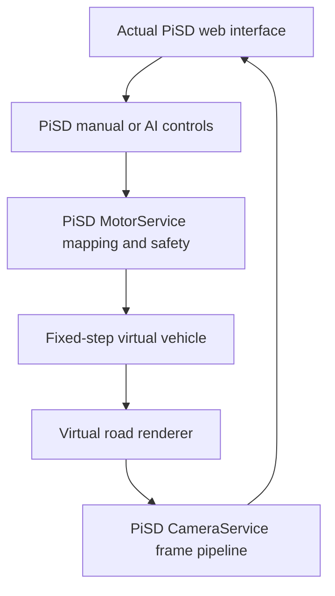

# PiSD Emulator

PiSD Emulator is a local development app for running PiSD without a Raspberry Pi or RC car. It starts the actual PiSD Flask application and web pages with a virtual motor adapter and a camera renderer that follows the simulated vehicle.

This component has no independent version number. Progress is tracked by the functional milestones in [ROADMAP.md](ROADMAP.md) and the requirement table in [REQUIREMENTS.md](REQUIREMENTS.md). The PiSD integration in this patch is `PiSD_0_11_47`, reconciled with Performance Update 1 at `PiSD_0_11_46`.

## Install and launch

From the PiDrive repository root:

```bash
python -m pip install -r PiSD/requirements.txt
python PiSD_Emulator/run_emulator.py --open-browser
```

The control workspace opens at `http://127.0.0.1:8760/`. Click **Start PiSD** to start the actual PiSD interface at `http://127.0.0.1:5050/`. Change the local PiSD port before starting if port 5050 is already in use. The launcher does not accept a non-local bind address.

To use a chosen workspace directory:

```bash
python PiSD_Emulator/run_emulator.py --workspace ./local_emulator_workspace
```

The default workspace is `%LOCALAPPDATA%/PiSD_Emulator/workspace` on Windows and `$XDG_DATA_HOME/PiSD_Emulator/workspace` on Linux/macOS, falling back to `~/.local/share/PiSD_Emulator/workspace`. It holds the emulator copy of PiSD defaults, saved settings, AI models, recordings, and `config/emulator_settings.json`.

## How the runtime connects



The emulator injects adapters into PiSD's existing `CameraService` and `MotorService`. It does not copy the PiSD HTML or replace the motor mapping logic. Manual and AI controls pass through PiSD's service and safety paths before the virtual vehicle receives the wheel outputs.

Both the control workspace and PiSD server bind to `127.0.0.1`. Emulator mode creates PiSD with hardware disabled, and the app factory rejects an emulator started with hardware enabled. The emulator does not initialize GPIO or Picamera2.

## Current milestone features

- Actual PiSD manual-drive page embedded in the workspace, with desktop, tablet, and mobile viewport presets.
- Start, stop, and restart controls for the PiSD Flask app.
- Fixed 60 Hz differential-drive physics with acceleration, braking, dead zone, wheel separation, efficiency, motor delay, and adjustable simulation speed.
- Perspective first-person road image generated inside the PiSD camera capture pipeline. The first profiles are straight, left curve, right curve, S curve, and circle.
- Virtual GPIO/PWM readout built from PiSD's motor pins and hardware-level output values.
- Top-down vehicle view, track selection, pause, fixed-step advance, reset, and off-track/collision status.
- Camera resolution, frame rate, brightness, contrast, saturation, and flip settings affect rendered frames. Physical sensor-only settings are identified as unsupported in emulator status.
- Emulator settings, models, and recordings are isolated from the PiSD source tree. Generated recording and snapshot manifests say `synthetic_simulation`; trainer label fields are unchanged.
- Existing PiSD `AIDriveService` loads models from the emulator workspace and sends its outputs through the same virtual motor adapter. This path is implemented but has not yet been validated with a compatible model.

## Embedded interface (PiSD 0.11.48)

The actual PiSD page permits framing only by the exact loopback control origin selected by `--control-port`. Normal PiSD retains its frame denial policy. Open the controller using `127.0.0.1`, not a hostname alias. Runtime restart or port changes reload the frame. Browser qualification is tracked in CI; no physical hardware validation is implied.

## Validation

Run the emulator engine and service adapter checks from the repository root:

```bash
python -m compileall -q PiSD/pisd PiSD_Emulator
python PiSD_Emulator/scripts/test_emulator.py
python PiSD/PiSD.py --status-only
```

Live runtime and browser validation additionally require the PiSD dependencies. No physical Raspberry Pi hardware is required for the unit checks.

## Current limits

- The implementation environment did not have Flask installed, so the live server and browser workspace were not launched during this patch.
- Playwright tests, screenshots, browser JavaScript error capture, and full interaction regression are not yet implemented.
- The first renderer has five track profiles; custom scenarios, indoor/obstacle-course presets, replay/video input, and user-authored scenario editing are planned.
- Fault injection, Raspberry Pi resource profiles, network simulation, richer GPIO inputs, and automated evidence export remain planned.
- AI closed-loop driving needs a compatible model and live runtime verification. Synthetic training results do not predict real-car performance.

## Next milestone

Complete E02/E03 live verification: start the runtime with dependencies installed, use the actual browser Manual Drive page to steer the vehicle, confirm the resulting camera frame changes, and capture evidence for responsive layouts and safe STOP behavior. Then add Playwright regression coverage before claiming browser-test acceptance.


The unified 1.0.0 candidate follows the PiSD runtime version; the emulator has no independent release number. Existing 0.11.48 frame-policy repair remains in force. Qualification pending.

## E04/E05 — replay and camera-fault candidate

Open `http://127.0.0.1:8760/scenarios` (use the configured control port). Stop PiSD before selecting an existing workspace-relative `recordings/<date>/<session>` or `replay/<folder>`. Recording labels determine frame order; standalone JPG/PNG sequences use lexical filename order. The camera runs at its configured capture rate, not original recording timestamps. Looping is opt-in; exhaustion deliberately stops fresh capture. Replay is open-loop and does not respond to vehicle movement. No recorded motor commands are played back. Replay-derived recordings are identified in metadata. Copy input images into the isolated workspace; no arbitrary host path or video import yet.

While PiSD runs, inject a camera capture fault from the scenarios page; clearing it only restores the provider, not AI rearm. Stop the runtime to clear the injected fault. Existing local origin and hardware restrictions remain. Run `python PiSD_Emulator/scripts/test_scenarios.py` with TensorFlow CPU installed for real Keras model/recording/replay/fault checks. The fixture is deterministic and not an accuracy benchmark. Candidate CI pending; actual AI browser journey and piTrainer import remain separate.
