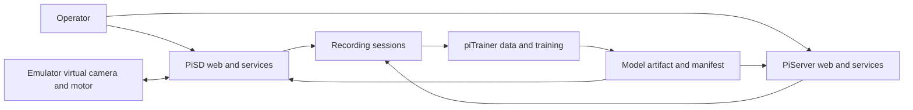

# Architecture and code map

Verified source inventory at main 8f593778eb461f8515f6c12c5fce936dc64cb301. This is a navigation map, not an exhaustive call graph. Confirm exact runtime wiring in the target revision before editing.

## Component boundaries

| Component | Entry point | Responsibility |
| --- | --- | --- |
| PiSD | [PiSD/PiSD.py](../../PiSD/PiSD.py) | Flask web drive, manual/AI control, camera and recording; safe simulation by default |
| PiServer | [PiServer/server.py](../../PiServer/server.py) | Separate Flask control, camera, model, recording and hardware ownership runtime |
| piTrainer | [piTrainer/main.py](../../piTrainer/main.py) | Qt desktop data review, preprocess, train, validate, export and TFLite checking |
| PiSD Emulator | [PiSD_Emulator/run_emulator.py](../../PiSD_Emulator/run_emulator.py) | Local virtual adapters and actual PiSD interface; no independent version line |

Diagram represents supported logical workflows, not automatic transfer or shared runtime processes. PiSD and PiServer are separate applications; do not assume interchangeable APIs, configs or simultaneous safe hardware ownership.

## PiSD ownership map

Under `PiSD/pisd/`:
- `app.py`: Flask factory, service wiring, routes, status assembly, settings and API coordination.
- `core/settings_manager.py`, `config_recovery.py`: persistent settings and recovery. Defaults `PiSD/config/defaults.json`; ordinary runtime settings `PiSD/config/runtime_settings.json`.
- `core/access_control.py`, `preflight.py`, `errors.py`: request access, startup/operational readiness and errors.
- `services/motor_service.py`, `ai_drive_service.py`, `ai_safety.py`, `autopilot_service.py`, `ai_correction.py`: actuation and AI command/safety paths. Review actual safety and lease/rearm behavior before any control change.
- `services/camera_service.py`: capture, effective camera settings and preview integration.
- `services/recording_service.py`, `recording_metadata.py`, `recording_recovery.py`, `core/recording_storage.py`: recorder lifecycle, labels, metadata, recovery and storage.
- `web/templates/`, `web/static/`, `core/panel_contracts.py`, `core/presentation_registry.py`: browser views and presentation contracts.
- `core/model_manifest.py`, `recent_events.py`, `request_trace.py`, `latency_metrics.py`: compatibility and bounded diagnostics.

## PiServer ownership map

Under `PiServer/piserver/`:
- `app.py`: routes, service construction and shutdown; `server.py` validates bind host before app construction.
- `services/control_service.py`, `motor_service.py`, `core/hardware_ownership.py`, `runtime_state.py`: command/control, ownership and runtime state.
- `services/camera_service.py`, `preview_yuv.py`: raw capture and optional native preview conversion. Keep preview resource policy separate from main inference/recording capture.
- `services/model_service.py`, `algorithms/`, `core/model_manifest.py`: model checks, inference and selected algorithms.
- `services/recorder_service.py`, `core/recording_storage.py`: recording lifecycle/storage.
- `core/config_store.py`, `config_recovery.py`, `access_control.py`, `preflight.py`: settings, recovery, access and readiness.
- `web/templates/index.html`, `web/static/`: dashboard, tabs, layout, controls and status. Preserve user layout/style state.

## Trainer ownership map

Under `piTrainer/piTrainer/`:
- `app.py`, `main_window.py`, `app_state.py`, `pages/`, `panels/`, `ui/`: application startup, shared UI state and workspace composition.
- `services/data/record_loader_service.py`, `session_service.py`, `selection_scope.py`, `filter_service.py`, `review_context.py`: ingestion, source identity, selection and review. Preserve order, missing-value semantics and legacy inputs.
- `services/data/preview_service.py`, `plot_service.py`, `overlay_service.py`, `overlay_*.py`: display and review computations, not authority to modify source labels.
- `services/data/edit_service.py`, `jsonl_atomic_service.py`, `visibility_service.py`, `delete_service.py`: persistent edits and protected deletion.
- `services/preprocess/`, `services/train/dataset_service.py`, `split_service.py`, `worker.py`, `experiment_service.py`, `model_service.py`: input normalization, splitting, training and provenance.
- `services/validation/validation_inputs.py`, `tflite_runner.py`, `validation_service.py`, `validation_provenance.py`, `validation_receipts.py`: preparation, inference, results and validation provenance.
- `services/export/export_service.py`, `services/data/model_deploy_service.py`: export artifact and transfer workflow; inspect model manifest contract.
- `services/background_task.py`, `task_outputs.py`: asynchronous work and output handling.

## Emulator ownership map

`PiSD_Emulator/pisd_emulator/runtime.py` starts/stops actual PiSD with an isolated workspace and virtual adapters. `engine.py` supplies vehicle simulation, `renderer.py` virtual camera frames, `control_app.py` local controller, `web/` workspace interface. Do not fork PiSD HTML into the emulator. Keep virtual outputs behind existing safety services; local origin and frame restrictions must remain enforced. See [emulator README](../../PiSD_Emulator/README.md).

## Change routing

Browser-only issue: inspect template/static code and actual API response before touching services. Incorrect effective setting: trace UI -> route -> normalization -> persistence -> service -> readback. Bad motor/camera behavior: trace ownership, command freshness, safety and adapter, not just the label. Trainer issue: trace source/session identity and data/worker service before changing table display. Shared model/recording issue: inspect producer and consumer together, add cross-component parity tests.
